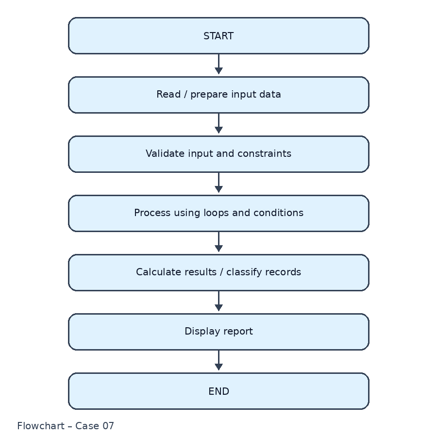
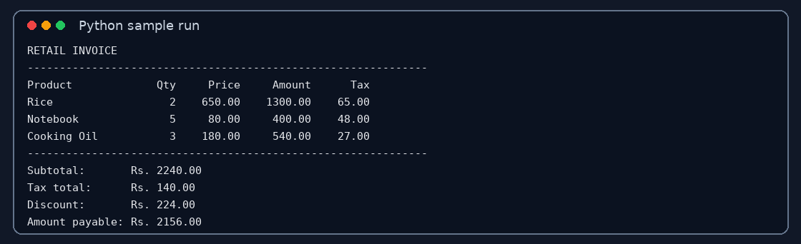

# Case Study 07: Retail Billing with Multiple Discount Rules

## 1. Problem Statement
Create an itemized retail invoice for several products. Apply category-specific tax, a threshold discount, and a maximum concession limit.

## 2. Objectives
- Store product details and quantities using lists/tuples.
- Calculate item totals, category taxes, discounts, and the final payable amount.
- Display a clear itemized invoice.

## 3. Assumptions
- Each product is represented by (name, category, unit_price, quantity).
- Tax rates are 5% for groceries and 12% for other categories.
- A 10% discount applies when the pre-tax subtotal is at least ₹2,000; discount is capped at ₹500.
- The discount is applied to the subtotal before tax.

## 4. Algorithm
1. Read the product records.
2. Validate positive prices and quantities.
3. Calculate each line amount and accumulate subtotal and category-wise tax.
4. Calculate the threshold discount and apply the maximum cap.
5. Add tax and subtract discount to obtain the final amount.
6. Print the itemized invoice.

## 5. Flowchart
The diagram below shows the overall program flow. Detailed case-specific decisions are implemented in `solution.py`.



## 6. Pseudocode
```text
START
SET products to a list of product tuples
SET subtotal and tax_total to 0
FOR each product tuple
  UNPACK name, category, price, quantity
  CALCULATE line_total = price × quantity
  ADD line_total to subtotal
  SELECT tax rate using category
  ADD line_total × tax rate to tax_total
END FOR
IF subtotal ≥ 2000, discount = MIN(10% of subtotal, 500), ELSE discount = 0
CALCULATE payable = subtotal + tax_total - discount
DISPLAY invoice and totals
STOP
```

## 7. Python Source Code
See [`solution.py`](solution.py). The program uses Python built-in features and no third-party packages.

## 8. Test Cases

| Test | Input / condition | Expected result |
|---|---|---|
| Normal mixed-category bill | Products shown in sample program | Subtotal ₹2,390; tax ₹273.80; discount ₹239; payable ₹2,424.80 |
| Below discount threshold | One grocery item: ₹500 × 1 | Discount ₹0; tax ₹25; payable ₹525 |
| Maximum discount cap | Other item: ₹6,000 × 1 | Discount ₹500 (not ₹600); tax ₹720; payable ₹6,220 |
| Invalid quantity | Quantity 0 | ValueError is raised |

## Sample Output
The included program was run with the sample data in `main()`. The captured output is also saved as `sample_output.txt`.



## 9. Output Screenshot
This terminal-style screenshot is a generated capture of the sample program output. Run `python solution.py` to reproduce it.

## 10. Conclusion
The program generates an itemized invoice and applies category taxes and discount limits accurately. It uses tuples, unpacking, lists, loops, conditions, and arithmetic operators.
